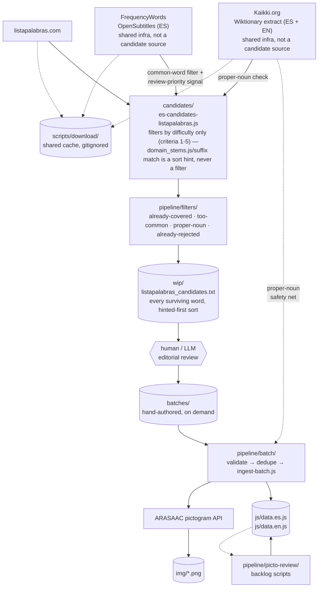
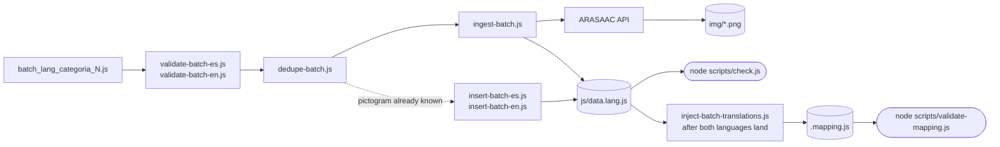
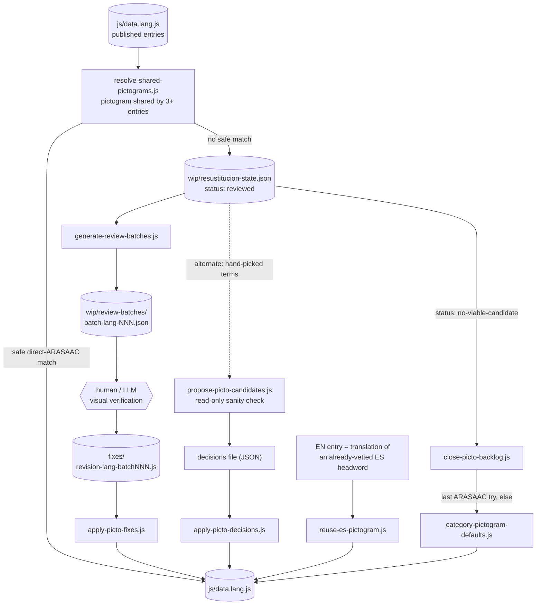

# scripts/ingest/

Versioned ingestion toolkit for the Spanish and English dictionaries.
The reusable pipeline, filters, rejection registers, this guide, and
`PROGRESS.md` are part of the repository. Local batches, downloads,
exploration scripts, fixes, repair scratch work, and active review evidence
remain ignored; see the root `.gitignore`. For editorial criteria and
sourcing techniques, see
[`doc/en/creating-elements-guide.md`](../../doc/en/creating-elements-guide.md)
/ [`doc/es/guia-crear-elementos.md`](../../doc/es/guia-crear-elementos.md)
§3-4. The root `scripts/` directory holds shared site tools; this
subdirectory holds the reusable ingestion pipeline and its operating
record. Its bulky and temporary working areas are excluded from Git so
the repository keeps the reproducible process without carrying every
download, candidate batch, or intermediate audit artifact.

## Token discipline: what must be a script vs. what may spend tokens

An AI agent working in this tree has a real, non-obvious cost: every
step it does "by reasoning" instead of by running a script burns
tokens for work a script would do for free and more reliably. Exactly
three steps in the whole pipeline are allowed to spend tokens, because
they are the actual product-quality work — everything else **must**
run through a script (existing or newly written under `pipeline/` or
`explore/`, never done by hand-reasoning or by editing `js/data.<lang>.js`
directly):

1. **Editorial word selection** — deciding, for each candidate in a
   sourced/filtered list, whether it genuinely belongs per
   `guia-crear-elementos.md` §3's criteria (real personal-document use,
   not already covered under a different wording, not too common, not
   a Wiktionary false-positive domain tag, etc.).
2. **Content authoring** — writing `definicion`/`sinonimos`/`ejemplo`/
   `ejemploSinonimo`/`alt` in easy-read Spanish/English for each
   accepted word.
3. **Pictogram visual verification** — downloading and actually
   viewing (Read tool) the ARASAAC candidate image(s) before trusting
   an automatic match, per the "ingest-batch.js's automatic ARASAAC
   match is frequently wrong" note in `PROGRESS.md`.

Everything else is mechanical and must be scripted, including but not
limited to: scraping a source, running the shared `filters/` (coverage,
common-words, refine-coverage, proper-noun), deduping against
`js/data.<lang>.js`, slugifying an `id`, searching/downloading ARASAAC
pictograms in bulk (`batch-pictogram-search.js` for cheap text-only
scouting, one call per batch — never one ad hoc lookup per word),
appending the finished entries to `js/data.<lang>.js`
(`ingest-batch.js`/`insert-batch-*.js`), injecting `traduccion` links
(`inject-batch-translations.js`, or a small one-off script following
the same anchor-based pattern for cases it doesn't cover), applying
pictogram fixes (`apply-picto-fixes.js`), and bumping the `?v=`
cache-busting hashes / `sw.js` `VERSION` (`scripts/check.js` reports
the correct hash — copy it, don't recompute it by hand).

### Synonym-based duplicate rule

The dictionary models one sense with one entry. Before accepting a candidate,
run `node scripts/ingest/pipeline/audit-synonym-duplicates.js es` (or `en`)
and review cases where a synonym points to an existing headword. Mutual
synonym references, matching definitions, and matching topics are strong
signals, but never merge automatically: a shared synonym can describe only
one sense, and bad source data can copy a definition to an unrelated word.
When a merge is confirmed, record the canonical and alias ids in
`pipeline/decisions/synonym-merges-<lang>.json`; the builder and shared
ingestion loader keep one entry and preserve the removed lemmata as searchable
synonyms. Record confirmed bad synonym links or related editorial corrections in
`pipeline/decisions/synonym-corrections-<lang>.json`. The UI displays the alias the person searched. Keep separate
entries for distinct senses and homonyms. Each batch validator also reports
when a candidate's synonyms overlap existing headwords, or vice versa, so the
review happens before insertion. Run the audit with `--out path.json` to save
the complete report; the default output is limited to its highest-priority
candidates.

**Pictogram visual verification, cheaply**: fetch the ARASAAC
`_300.png` preset (300×300, ≈120 vision tokens) for the temporary copy
you view with the Read tool to decide — not the `_500.png` (≈333
tokens) the pipeline scripts write into `img/<id>.png` for the live
site. ARASAAC's flat, high-contrast icon style stays legible at 300px
for the coarse "does this depict the right concept" judgment that most
QA calls are; fall back to `_500`/`_2500` only when the 300px copy is
ambiguous or the case is sensitive enough to need the extra detail
(small embedded text, a subtle gesture/object distinction). This only
changes what you download to *decide* — every script that writes the
committed asset (`ingest-batch.js`, `apply-picto-fixes.js`,
`apply-picto-decisions.js`, `close-picto-backlog.js`,
`resolve-shared-pictograms.js`) already fetches `_500.png` and must
keep doing so; never lower the resolution of the file that ships.

Concretely, before doing any of the above "by hand": check whether an
existing script in `pipeline/` already does it: if yes, run it; if it's
close but doesn't quite fit (e.g. needs to target one situación
instead of the whole run), extend it with a minimal flag rather than
reasoning through the equivalent work manually. Never read
a multi-MB `js/data.<lang>.js` directly to check coverage or count
entries — use `content-status.js` (or a filter's own loader) instead.
Two symptoms mean this rule was skipped somewhere: a review session
that re-litigates candidates already decided in a prior `PROGRESS.md`
entry, and a pictogram chosen without its image ever having been
viewed. The first symptom has a dedicated fix now: every
`candidates/` script consults `filters/rejected-words.js` (backed by
`pipeline/filters/rejected-words-es.txt` / `rejected-words-en.txt`, plain
one-word-per-line lists) alongside the coverage/common-word filters, so
a word already declined in a past review is dropped automatically
instead of reaching a human/LLM reviewer a second time. When an
editorial review does decline a word, record it with
`node scripts/ingest/pipeline/shared/record-rejection.js --lang
<es|en> word1 [word2 ...]` (`--reason`/`--category` are accepted but not
persisted — put the "why" in your PROGRESS.md entry instead when it's
worth explaining) — recording the decision is mechanical, so it goes
through that script like every other bookkeeping step, never a hand-edit
of the list.

## Layout

```
scripts/download/      ← ONE shared cache for the whole project (not under scripts/ingest/ — see below)
scripts/ingest/
├── PROGRESS.md        ← execution status / decision log, one section per source
├── pipeline/          ← ingestion pipeline + candidate sourcing
│   ├── batch/         ← runs on every batch: validate → dedupe → ingest → pictograms
│   ├── candidates/    ← one script per external source (or per merged pool) — see below
│   ├── decisions/     ← reviewed editorial synonym merges
│   ├── picto-review/  ← second workflow: fixes pictograms already in js/data.<lang>.js
│   ├── filters/       ← shared pre-filters every candidate-sourcing script must consult
│   │                    (includes rejected-words-es.txt/rejected-words-en.txt, hand-curated
│   │                    filter state, not a download)
│   └── shared/        ← other reusable modules (not filters, not sourcing scripts)
├── batches/           ← local-only input files: module.exports = [ {palabra, ...}, ... ]
├── fixes/             ← local-only pictogram repair batches
├── explore/           ← local-only one-off scratch scripts — see below
├── repair/            ← local-only repair scripts and working data
└── wip/               ← local-only active review/decision state and evidence
```

`pipeline/`, the top-level README, and `PROGRESS.md` are versioned.
`explore/`, `batches/`, `fixes/`, `repair/`, and `wip/` are ignored local
working areas; create them when a task needs them. Scripts that read from
them (`ingest-batch.js`, `apply-picto-fixes.js`, etc.) do not create the
directories themselves. Delete a one-off script from `explore/` once its
task is done, not just its output.

**2026-09-05: `download/` moved up to `scripts/download/`, merging what
used to be two separate cache directories** (`scripts/download/` and
`scripts/ingest/download/` — user's call: one shared cache for the whole
project). It sits outside `scripts/ingest/` on purpose now because the
tracked, shipped `scripts/corpus-candidates.js` also uses it as a shared
cache. The `scripts/clean-downloads.js` tool manages that cache and
deliberately leaves the ignored work areas under `scripts/ingest/` alone.
See its own header for cache exclusions; some source data is expensive to
fetch again. Temporary review state is also preserved because deleting a
maintainer's work-in-progress automatically is worse than letting it grow.

### Big picture: source → dictionary

**2026-09-09: this diagram used to show six independent candidate
sources (Kaikki, Wikimedia, wordfreq, CEFRLex, Wikipedia,
Wiktionary-by-category) feeding a general merge pipeline plus a
separate listapalabras.com path.** Five of those six are now closed —
each source's own script surfaced everything it was going to find
(see `PROGRESS.md`'s Sources table for the final counts) and was
removed once exhausted: `es-candidates-kaikki.js`,
`es-candidates-wikimedia.js`, `es-candidates-freqwords.js`,
`es-candidates.js` (their merge step), `general_pool_domain_stems.js`,
`cefrlex_candidates.js`, `en-candidates-wordfreq.js`,
`en-candidates-kaikki-cefrlex.js`, `wikipedia_candidates.js`, and
`wiktionary_candidates.js` (removed 2026-09-09 specifically — its
category-cross-reference output was being used as an *exclusion
filter* on other word lists, which `guia-crear-elementos.md`/
`creating-elements-guide.md` §3.2 criterion 6 explicitly rules out;
see that file's method-F entry for the full reasoning). Their cached
downloads went with them.

`es-candidates-listapalabras.js` is the one surviving, currently
maintained candidate-mining script. It still depends on two pieces of
shared infrastructure that are **not** source-specific leftovers, so
they were kept: the Kaikki `.jsonl.gz` extracts (also the ongoing
proper-noun safety net every batch insertion consults, regardless of
source) and `freq-es.txt` (also `filters/common-words.js`'s backing
data).

Everything below eventually funnels into one of two places:
`js/data.<lang>.js` (content) or `img/*.png` (pictograms).



## `pipeline/` — ingestion pipeline + candidate sourcing

Five subdirectories, each a distinct workflow. None of the scripts in
any of them is required to ship content (you can edit
`js/data.<lang>.js` by hand) — they exist to make bulk work less
error-prone. Moved out of a single flat `pipeline/` directory
2026-09-04 once it became clear it was silently holding at least three
unrelated workflows (every-batch ingestion, candidate sourcing, and
pictogram backlog review) as one undifferentiated pile of scripts.

### `pipeline/batch/` — every-batch ingestion

These are run on every batch, in roughly this order.

| Script | Purpose |
| --- | --- |
| `validate-batch-es.js` / `validate-batch-en.js` | Pre-flight check on a batch file (same easy-read rules as `scripts/check.js`, but scoped to the batch). Catches `ejemplo.palabra` not in `ejemplo.texto`, missing required fields, etc., before they land in `js/data.<lang>.js`. |
| `dedupe-batch.js` | Drops entries from a batch whose `id` or `palabra` already exists in `js/data.es.js`. Outputs the kept entries to stdout. |
| `audit-synonym-duplicates.js` | Lists entries connected because a synonym matches another headword. Ranks mutual links with identical definitions first; output is a review report, never an automatic merge. |
| `ingest-batch.js` | The main ingest: appends a deduped, validated batch to `js/data.<lang>.js`, searching ARASAAC for each entry's pictogram and downloading it into `img/` if missing. |
| `insert-batch-es.js` / `insert-batch-en.js` | Format-only variant: writes the batch to `js/data.<lang>.js` without the ARASAAC search (use this when the pictogram is already known or the batch has no pictogram terms). |
| `inject-batch-translations.js` | After an EN batch is inserted, injects the `traduccion: { en: "<id-en>" }` field into the corresponding ES entries (mirrors what `scripts/inject-translations.js` does for the global `scripts/.mapping.js`). |
| `apply-picto-fixes.js` | Apply a `fixes/` file to `js/data.<lang>.js`: rewrites the `imagen.id` and `imagen.alt` for a list of ids, downloading the new pictogram into `img/` if it's not already there. |
| `batch-pictogram-search.js` | One-shot ARASAAC search across a list of terms, returning the first few non-schematic candidates per term. Use this to scout pictograms for an entire batch in one pass before you commit to downloading them. |
| `batch-status.js` | Batch-status sweep across every file in `batches/`: which ones fully landed in `js/data.<lang>.js` (safe to delete), which are partial, which were never run through the pipeline. See the batch-tracking section of `creating-elements-guide.md` / `guia-crear-elementos.md`. |

Candidate-sourcing (`es-candidates-listapalabras.js`, the sole
survivor — see `PROGRESS.md`'s Sources table for what closed the
rest) is not part of this every-batch flow — see
[`pipeline/candidates/`](#pipelinecandidates--one-script-per-source)
below.

### `pipeline/filters/` — shared pre-filters

**Design rule: every candidate-sourcing script in this tree must consult
these before doing its own analysis** — never re-scan `js/data.*.js`
locally. Past duplicates (several now-removed candidates/ scripts and
half of `explore/`) had each grown a slightly different, sometimes
buggy copy of the same "already covered" check (one dropped
accent-folding, another skipped the `ejemplo` fields) before this
was enforced.

| Module | Drops a word if... | Threshold rationale |
| --- | --- | --- |
| `sinonimia-coverage.js` | full app-findability view: it's already `palabra`, a `sinonimos[]` entry, or an `ejemplo`/`ejemploSinonimo` word in `js/data.es.js`/`js/data.en.js` | exact match, never a false positive; candidate mining uses its headword-only view so independent lexical forms remain reviewable |
| `common-words.js` | it's among the ~400 most frequent words in `scripts/download/freq-es.txt` | see the file's header — the threshold is calibrated against real editorial calls, don't raise it without re-checking |
| `refine-coverage.js` | its plural/singular form is covered by the above (`loadRefinedCoverage(lang)`, run AFTER the two above, not instead of them) | plural-variant expansion only. Originally also scanned `definicion` text; dropped after real-data testing showed it false-matches ordinary connective words in unrelated entries' prose (e.g. "forma"/"cosa"/"causa") — see the file's header for the audit before ever re-adding that. |
| `rejected-words.js` | a maintainer already reviewed it and declined it for an editorial reason (redundant with an existing entry under a different wording, archaic, out-of-scope jargon, etc.) | not a threshold — an exact (accent-insensitive) match against `rejected-words-es.txt` / `rejected-words-en.txt`, plain append-only one-word-per-line lists living right in `pipeline/filters/` next to this module (moved out of `wip/` 2026-09-05 — user's call: unlike the other filters' backing data, this has no source it's regenerated from, so it belongs with the code that defines the filter). Simplified the same day from a JSON registry that also carried a reason/category/date per word, since no filter ever queried those back out; explain a notable rejection in PROGRESS.md's prose instead. Closes the gap `sinonimia-coverage.js` (only catches words that LANDED) and `common-words.js` (only frequency-based) both leave open: a DECLINED word has no other structured record, so without this it can resurface — and cost a second editorial review — the next time a source is re-mined or a different source happens to hit the same word. See PROGRESS.md's "listapalabras.com" delta-review section for a case where this happened before this filter existed. Append with `pipeline/shared/record-rejection.js` (`--lang`, then the words; `--reason`/`--category` are accepted but ignored) — never hand-edit the list to add a new entry, only to correct/remove a stale one. |

**2026-09-09:** `known-names.js` (an English name/place-name list) and
its builder `pipeline/shared/build-proper-noun-list.js` were removed —
both were only ever consulted by candidate-mining scripts closed and
deleted this same day (`cefrlex_candidates.js`,
`en-candidates-kaikki-cefrlex.js`, `wikipedia_candidates.js`,
`wiktionary_candidates.js`), leaving zero remaining callers.
`es-candidates-listapalabras.js` (the one surviving script) never used
it — it relies on `shared/proper-noun-check.js`'s Kaikki-based check
instead, which is unaffected and still runs on every batch insertion.

`sinonimia-coverage.js` and `common-words.js` degrade to a no-op
(`available: false`) if their cache file is missing, with a required
visible warning — same contract as `shared/proper-noun-check.js`'s Kaikki
guard. `common-words.js` has no English backing list, so EN-facing
scripts skip that one filter (noted inline where relevant). `dedupe-batch.js`
(id/palabra match at insertion time) and `scripts/corpus-candidates.js`
(a root-level shared tool, so it must stay self-contained — see its own
comment) intentionally don't
`require` any of these — different scope or a hard dependency-direction
constraint, not an oversight.

#### "Processed" = landed ∪ rejected (with one deliberate exception)

A candidate word counts as **processed** — a past editorial decision
exists, so a future mining pass must not show it to a reviewer again —
when it's in exactly one of two places: **landed**
(`sinonimia-coverage.js`, the word is now in `js/data.es.js`/
`js/data.en.js`) or **rejected** (`rejected-words.js`, a maintainer
declined it). Together they're the complete "already decided" set for a
given language; a word matching neither one is still open, whether
because nobody has looked at it yet or because a source was only
partially reviewed.

The one deliberate exception: a handful of words PROGRESS.md records as
**"flagged, needs a maintainer call"** (e.g. the Wikipedia section's
Acidosis/Empleabilidad/Subcontratación) are genuinely undecided —
neither landed nor rejected on purpose, so they correctly keep
resurfacing in any future shortlist of that source until someone
actually decides. `explore/backfill_wikipedia_rejects.js` (since
deleted, its job done — see PROGRESS.md) explicitly excluded these from
being recorded as rejected for exactly this reason; don't record a
flagged word as rejected just to make it stop reappearing — that would
misrepresent a real, still-open decision as a closed one.

#### Who actually consults coverage + rejected-words

`es-candidates-listapalabras.js` — the one surviving `candidates/`
script — `require`s `filters/refine-coverage.js` (coverage) and
`filters/rejected-words.js` (rejected-words) directly. If you ever add
another candidate-sourcing script here, it must consult both the same
way, per the design rule in `pipeline/filters/`'s own section above.

### `pipeline/shared/` — reusable modules that aren't filters

Every one of these is `require`d by more than one script, some of them
across the `pipeline/`/`candidates/` boundary — the same reason
`filters/` lives inside `pipeline/` rather than duplicated per caller.
None of them drops a candidate the way a `filters/` module does, so
they don't live there; `load-dict.js` used to sit in `filters/` despite
being (as its own table row said) "not a filter" — moved out 2026-09-04.

| Module | Used by | Purpose |
| --- | --- | --- |
| `normalize-word.js` | `filters/sinonimia-coverage.js`, `filters/common-words.js`, `shared/proper-noun-check.js`, `candidates/es-candidates-listapalabras.js` (+ `filters/refine-coverage.js`, indirectly, via `sinonimia-coverage.js`'s re-export) | Exports `normalizeWord()`: canonicalizes a word for comparison (NFD + strip combining marks + lowercase + trim). Extracted 2026-09-04 — existed as 8 independent copies in three different styles across `filters/`, `shared/`, and `candidates/` before that, the same "each script grows its own slightly different copy" problem `filters/` itself exists to prevent, one level lower (the primitive every higher-level check is built on was never itself shared). Verified all 8 old copies against the new one on a real word battery before removing them — five lacked `.trim()`, everything else matched exactly. |
| `load-dict.js` | `filters/sinonimia-coverage.js` | Loads `js/data.<lang>.js` into a Node-usable object (rewrites the browser-only `window.DICCIONARIOS` assignment). Not itself a filter — just the loader the coverage filter is built on. |
| `proper-noun-check.js` | `batch/ingest-batch.js`, `batch/insert-batch-es.js`, `batch/insert-batch-en.js`, `candidates/es-candidates-listapalabras.js` | Kaikki-backed guard: flags a word whose only genuine Wiktionary sense is `pos: "name"`. Per-language Kaikki cache path matters here — see the file's header for a 2026-09-04 fix where the EN path pointed at the wrong cache directory and silently no-opped. Not source-specific: this is the same guard every future batch insertion consults, regardless of which source found the word. |
| `domain_stems.js` | `candidates/es-candidates-listapalabras.js` | Hand-picked domain-indicative word stems per AIVD category, one set per language. Moved from `explore/` here so consumers reach it the same way `filters/` consumers do. Used purely as a review-order hint — see that script's header for the 2026-09-09 removal of the category-as-filter design this used to support. |

Typical end-to-end flow (one batch, ES side):



```sh
# 1. Pre-flight on the batch file
node scripts/ingest/pipeline/batch/validate-batch-es.js \
     scripts/ingest/batches/batch_es_finanzas_1.js

# 2. Drop entries already in the dictionary
node scripts/ingest/pipeline/batch/dedupe-batch.js \
     scripts/ingest/batches/batch_es_finanzas_1.js

# 3. Insert into js/data.es.js (with ARASAAC pictogram search)
node scripts/ingest/pipeline/batch/ingest-batch.js \
     scripts/ingest/batches/batch_es_finanzas_1.js es

# 4. Re-run the full validator on the merged data
node scripts/check.js
```

Repeat the equivalent EN steps. After both languages are in,
`scripts/ingest/pipeline/batch/inject-batch-translations.js` wires the
ES→EN links, and `node scripts/validate-mapping.js` confirms the
mapping still covers every entry that needs an explicit link.

### `pipeline/picto-review/` — pictogram review & backlog scripts

A second, separate workflow from the "every batch" one above: fixing
pictograms for entries that are **already in** `js/data.<lang>.js`
(overused shared images, no exact ARASAAC match at ingest time), not
for entries about to be inserted. State is tracked across runs in
`wip/resustitucion-state.json`. See `PROGRESS.md`'s "Pictogram
semantic review batches" section for where this backlog currently
stands.



| Script | Purpose |
| --- | --- |
| `resolve-shared-pictograms.js` | Entry point: finds every entry whose `imagen.id` is shared by more than 2 entries and tries OpenSymbols/ARASAAC directly. Auto-applies a safe (non-schematic, direct-ARASAAC) match; anything else is marked `"reviewed"` in the state file for the next two scripts to pick up. |
| `generate-review-batches.js` | For every `"reviewed"` entry, gathers a richer, unfiltered ARASAAC candidate pool (palabra + synonyms + individual words) and writes `wip/review-batches/batch-<lang>-<n>.json`, ~40 entries per file, for a human/LLM to judge semantic fit — ARASAAC's own fuzzy search can't be trusted to. |
| `propose-picto-candidates.js` | Read-only sanity check: given a decisions file of hand-picked terms per entry, prints each ARASAAC candidate's *full* keyword list (not just the matched tag), so a homograph (e.g. "hacienda" the tax authority vs. a rural-house pictogram tagged "hacienda") is caught before anything is written. |
| `apply-picto-decisions.js` | Applies a decisions file of hand-picked terms per entry, only auto-accepting a candidate when one of its own keyword tags is an exact match for the search term — the same safety rule `resolve-shared-pictograms.js` uses. |
| `reuse-es-pictogram.js` | For an EN entry that's the translation of an existing, already-vetted ES headword, copies that ES entry's current `imagen` directly instead of searching ARASAAC again. |
| `close-picto-backlog.js` | Final fallback, scoped only to entries hand-confirmed as `"no-viable-candidate"`: gives ARASAAC one more real shot, then falls back to the entry's `situacion` category-default pictogram (`../../../category-pictogram-defaults.js`). |

### `pipeline/candidates/` — one script per source

**2026-09-09: down to one script.** This directory used to hold up
to ten scripts across six independent sources (Kaikki ES/EN,
Wikimedia, rspeer/wordfreq, CEFRLex, Wikipedia categories, Wiktionary
sense-domain categories). Every one of those sources is now closed —
mined to exhaustion, documented in `PROGRESS.md`'s Sources table, and
its script deleted — except `wiktionary_candidates.js`, which was
removed for a different reason: its category-cross-reference output
was being used as a *filter* on other candidate lists (see the
"Big picture" diagram above and `guia-crear-elementos.md`/
`creating-elements-guide.md` §3.3 method F), which
`guia-crear-elementos.md` §3.2 criterion 6 explicitly forbids — the
editorial criterion is a word's difficulty, never whether an external
category API happened to tag it.

| Source | Script | Notes |
| --- | --- | --- |
| listapalabras.com | `es-candidates-listapalabras.js` | One script, two stages: scrapes the whole site into a raw headword list (stage 1, output as `download/listapalabras_words_es.txt` — no subdirectory, flat like everything else in `download/`), then filters it (stage 2) by difficulty criteria only — word shape, `filters/refine-coverage.js`, a Kaikki-backed proper-noun check, `filters/common-words.js`, `filters/rejected-words.js` — never by domain category. Every survivor is a real candidate; `shared/domain_stems.js` plus a small admin/legal/labour suffix list (`HINT_SUFFIXES`) only decide *review order* (hinted-first), not inclusion. Writes `wip/listapalabras_candidates.txt`. See `PROGRESS.md`'s listapalabras.com section for the full funnel history, including the 2026-09-09 removal of the old category-filter design. |

Wiktionary and Wikipedia each used to have three or four scripts that
had grown around them over separate sessions (different `PLAN`
subsets, a dedicated retry-after-rate-limit pass, a separate
formatter), each a few dozen lines apart from the others and each
re-implementing its own "already covered" check with its own bugs.
Consolidated 2026-09-04. `strip_in_sinonimia.js` (patched a
`candidates_<lang>.txt` / `candidates_<lang>_in_sinonimia.txt` overlap
bug in the pre-refactor `es-candidates.js`/`en-candidates-kaikki-cefrlex.js`) was
removed the same day: re-tested against the current, shared-filter-
based scripts and the overlap bug no longer reproduces (0 removed / 0
dupes on a full run, both languages).

If you're about to add a `_v2` or `_retry` script for a source that
already has one here, that's a sign to extend the existing script's
`PLAN`/retry logic instead.

## `batches/` and `fixes/` — data files, not code

A "batch" is a `module.exports = [ {...}, ... ]` array of candidate
dictionary entries (the same shape as entries in `js/data.<lang>.js`,
minus the `imagen.id` which the pipeline fills in). A "fix" is a
`module.exports = [ {id, imgId, alt}, ... ]` array of
pictogram-id/alt corrections.

Both directories hold **data** (not scripts), even though the files
end in `.js` (they have to be `require`-able). Treat them as
content-area artifacts:

- They are not linted by `scripts/check.js` (it only checks
  `js/data.<lang>.js`).
- They are not run as scripts.
- You can delete them freely after a batch lands in the data files —
  the canonical content is in `js/data.<lang>.js`, not here.

## `explore/` — true one-off scripts

The original `scripts/.scratch/` convention. Throwaway queries: list
entries in a category, search ARASAAC for a term, count words, etc.
Name them `<topic>_<purpose>.js` (e.g. `legal_audit.js`,
`salud_gaps.js`). Drop them here, not in the repo root. They have
no test value — running them is the value.

**Empty by default** (2026-09-04): this directory used to also hold
the candidate-sourcing scripts (`wiktionary_candidates.js` and
friends), kept as the sole exception to "true one-off" since they
accumulate rather than get thrown away. That exception moved to
[`pipeline/candidates/`](#pipelinecandidates--one-script-per-source)
once it became clear those scripts don't fit "one-off" at all — an
empty `explore/` between sessions is now the expected, normal state,
same as `batches/`/`fixes/`. The directory itself doesn't exist on
disk right now (deleted once it held nothing); `mkdir` it back the
next time a genuine one-off script needs somewhere to live.

## `wip/` — work in progress (renamed from `one-off/` 2026-09-04)

Not ephemeral scratch — the old `one-off/` name and description ("logs,
patches, nothing here is part of the workflow") stopped being accurate
once real, substantial content accumulated here: the active review
backlog (`review-batches/`, `resustitucion-state.json`) and,
historically, downloaded reference data that fed ongoing review.
Renamed once that became clear, rather than letting a misleading
directory name suggest it's safe to delete.

**2026-09-05: this directory shrank twice the same day.** The
downloaded candidate dumps moved out to `download/`
(`wiktionary_candidates.txt`, `wikipedia-candidatos-completo.md`,
`wikipedia_survivors.txt` — see that section below and PROGRESS.md) —
they're downloaded source data like everything else there, just an
expensive-to-re-fetch kind, which `clean-downloads.js` now protects
with an explicit exclude instead of this directory never being touched
at all. Then `rejected-words-es.txt`/`rejected-words-en.txt` moved out
to `pipeline/filters/`, right next to the `rejected-words.js` module
that reads them — unlike everything else that used to live here, that
data has no source it's regenerated from, so it belongs with the
filter's own code, not in a review-state or downloaded-cache bucket.
`wiktionary_es_domain_categories.txt` (the `--list-categories`
discovery-pass output) is the one exception that stayed — it's closer
to review state than to either of those.

What actually belongs here:
- **Active review/decision state** — `resustitucion-state.json`,
  `review-batches/*.json`, `wiktionary_es_domain_categories.txt`. Don't
  delete these; see `PROGRESS.md` for what's still pending in each.
- Genuine one-off scratch (a `git format-patch` output, a local server
  log) still belongs here too, in the old sense — it's just no longer
  the *only* thing this directory holds. It is gitignored along with
  the rest of `scripts/ingest/`. `scripts/clean-downloads.js` does not
  clean it for you, so prune true scratch by hand — but check
  `PROGRESS.md` before deleting anything you didn't create yourself,
  since it's easy to mistake active review state for clutter (this is
  exactly what prompted the rename).

## Where scratch scripts MUST live (root is off-limits)

When exploring — batch-searching ARASAAC, dumping corpus entries,
prototyping a fallback strategy — the script that does it belongs in
`scripts/ingest/explore/`, **not** in the repo root. The root only
carries files that are part of the shipped site (`index.html`,
`404.html`, `wrangler.toml`, `CLAUDE.md`, `README.md`, etc.) and
tracked docs. A `.tmp_*.js` (or any other throwaway JS / shell
snippet) dropped at the top level is, at best, ignored by `.gitignore`
and at worst mistaken for a tracked file by a maintainer skimming
the tree.

Concretely:

- ✅ `node scripts/ingest/explore/<topic>_<purpose>.js`
- ❌ `node .tmp_<topic>_<purpose>.js`
- ❌ `./scratch.js`
- ❌ any `.js` / `.sh` file written directly under the repo root
  just because you'll "only run it once" — there is no such thing as
  a one-shot script in this repo, it will live longer than you think.

If a script is genuinely a one-shot that you intend to delete in
the same session, run it inline with `node -e '...'` — no file at
all. If it has to be a file for reuse within the session, put it in
`scripts/ingest/explore/`.

## Why a `pipeline/` and not a `test/`

Sinonimia has no test framework (`scripts/check.js` is the only
"test" CI runs, and it asserts invariants on real content). The
`pipeline/` scripts are not tests — they are ingestion helpers that
modify `js/data.<lang>.js` and `img/`. Putting them under `test/`
would be misleading.
